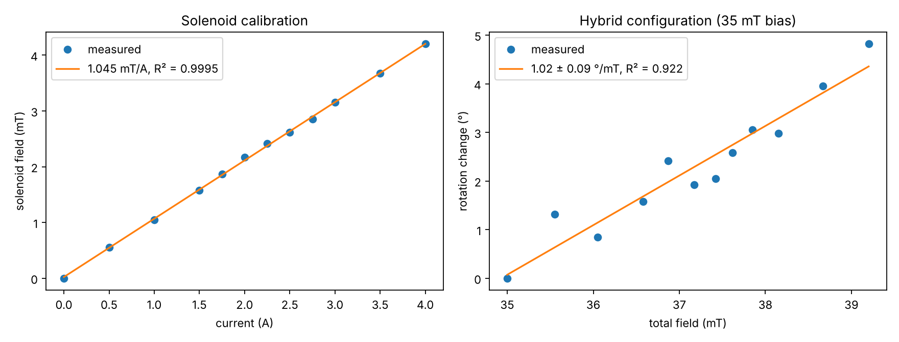

# Tunable fibre Faraday rotator at 1550 nm

Master's mini-project, Laboratoire de Photonique d'Angers (LphiA),
University of Angers. Eight weeks full time, defended on 3 March 2026.
Individual project under the guidance of a supervisor.

*Résumé en français plus bas.*

## Question

A Faraday rotator turns the polarisation of light by an angle fixed at
manufacture, usually 45°. In a commercial fibre device the material and its
length cannot be changed, so the only handle left is the magnetic field. The
project asked whether an external field can tune the angle of a commercial 45°
fibre rotator at 1550 nm, and which way of applying that field works best.

## Set-up and method

- All-fibre bench: 1550 nm DFB laser, isolator, the rotator on
  polarisation-maintaining fibre, a polarising beam splitter and two power
  meters.
- The rotation angle is derived from the power ratio between the two outputs,
  with a measurement without external field as reference (angle known modulo 90°).
- Three ways of applying the field, compared against the same criteria:
  ferrite ring magnets; a solenoid; a hybrid configuration where a magnet sets
  the operating point and the solenoid modulates it.
- The field was measured with a teslameter at each current.

## Results



| Configuration | Result |
|---|---|
| Ring magnets, opposing the internal field | Angle brought from about 44° to about 9° (three trials). Step-wise tuning only. |
| Ring magnets, aligned with the internal field | No measurable effect. |
| Solenoid alone | Field linear in current: 1.045 ± 0.008 mT/A (R² = 0.9995); too weak for a usable change in angle. |
| Hybrid (35 mT bias + solenoid) | Rotation linear in field: 1.02 ± 0.09 °/mT, i.e. 1.07 ± 0.10 °/A (12 points, R² = 0.92), 4.8° at 4 A. Only configuration giving continuous tuning. |

Uncertainties are one-sigma standard errors of the fits; they do not include
measurement uncertainties, which were not quantified.

## Limits and interpretation

- The field was measured next to the active region, not inside it.
- Small fluctuations of the polarisation state made readings harder.
- The device most likely uses a garnet close to magnetic saturation, which
  would explain why aligned magnets have no effect. In that regime the slope
  above is a sensitivity around the operating point. The defence slides quote
  it as an "experimental Verdet constant"; this repository keeps the more
  cautious reading. The saturation hypothesis was not checked by measuring the
  magnetisation.

## Repository contents

```
report/mini-project-report-2026-fr.pdf   full report (French, 43 pages)
presentation/defence-slides-2026-fr.pdf  defence slides (French)
data/hybrid_configuration.csv            the 12 measurement points of the hybrid configuration
src/faraday/
    coil.py            field at the centre of a multilayer solenoid, wire length
    magneto_optics.py  beta = V B d and its inverses (length or field for a target angle)
    analysis.py        linear fit with standard errors, data loading
scripts/
    analyse_hybrid.py  fits and figure of the hybrid configuration
    coil_design.py     coil sizing
    rotator_design.py  length needed for a target rotation at given fields
figures/                                 figure produced by analyse_hybrid.py
tests/                                   automatic tests
docs/notes-on-the-code.md                changes made to the original notebooks
```

## Running

```bash
pip install -r requirements.txt
python scripts/analyse_hybrid.py --out figures
python scripts/coil_design.py --current 1
python scripts/rotator_design.py --verdet <V in rad/(T m)> --rotation 45 --field-mT 10 100
python -m pytest -q tests
```

The coil script's default parameters (3.5 cm long, 25 layers, 700 turns)
describe a design study and predict about 16.8 mT/A. The solenoid used in the
experiment gave 1.05 mT/A; its final parameters differ from this design.

## Résumé en français

Mini-projet de Master 2 au Laboratoire de Photonique d'Angers (8 semaines,
soutenu le 3 mars 2026). Banc fibré à 1550 nm, comparaison de trois façons de
régler l'angle d'un rotateur de Faraday commercial par un champ magnétique :
aimants, solénoïde seul, configuration hybride. Seule la configuration hybride
donne un réglage continu, d'environ 1 °/mT autour d'un biais de 35 mT. Rapport
et présentation complets dans `report/` et `presentation/`.

## Author

Mouhssine Ait Said — [LinkedIn](https://www.linkedin.com/in/mouhssine-ait-said-111b03186/).
Supervision: LphiA, University of Angers. Publication of the code, data, report
and slides authorised by the supervisor.

## Licence

Code: MIT (see `LICENSE`). Report, slides and data remain the author's work and
may be cited, not reused without permission.
